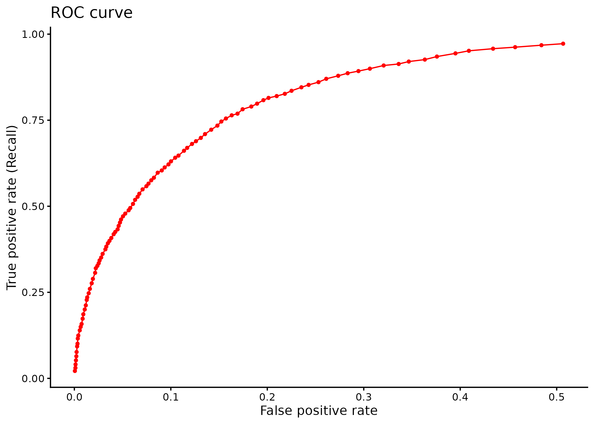
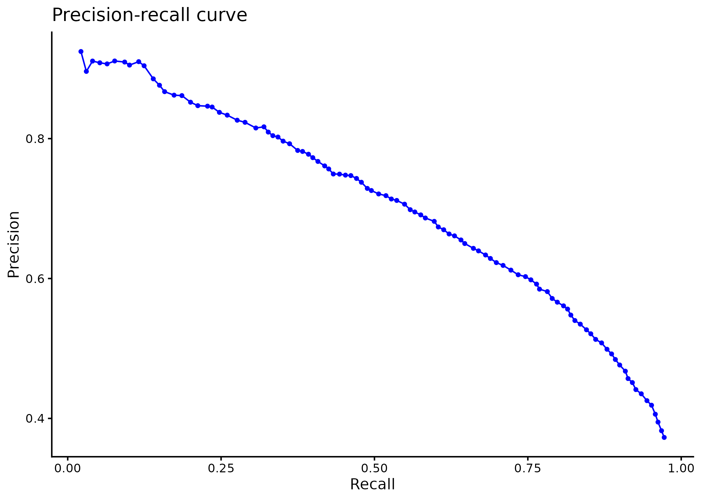

# m6APrediction

`m6APrediction` is an R package for predicting N6-methyladenosine (m6A) modification sites using a fitted random forest model. It supports batch prediction from a feature table and prediction for a single site. The package includes a fitted model and an example dataset.

## Installation

Install `remotes` if needed, then install the package from GitHub:

```r
if (!requireNamespace("remotes", quietly = TRUE)) {
  install.packages("remotes")
}
remotes::install_github("smileheart0088/m6APrediction")
```

## Usage

### Batch prediction

Load the bundled model and feature table, then predict the first three rows:

```r
library(m6APrediction)

model <- readRDS(system.file(
  "extdata", "rf_fit.rds",
  package = "m6APrediction", mustWork = TRUE
))

features <- read.csv(system.file(
  "extdata", "m6A_input_example.csv",
  package = "m6APrediction", mustWork = TRUE
))

result <- prediction_multiple(
  ml_fit = model,
  feature_df = features[1:3, ],
  positive_threshold = 0.6
)

result[, c("predicted_m6A_prob", "predicted_m6A_status")]
```

| Row | Predicted m6A probability | Predicted status |
| --- | ---: | --- |
| 1 | 0.876 | Positive |
| 2 | 0.000 | Negative |
| 3 | 0.498 | Negative |

To use your own feature table, provide the columns `gc_content`, `RNA_type`, `RNA_region`, `exon_length`, `distance_to_junction`, `evolutionary_conservation`, and `DNA_5mer`. Follow the preprocessing used for the training data. In the course data, exon length and distance to the junction are already log2-transformed.

### Single-site prediction

```r
library(m6APrediction)

model <- readRDS(system.file(
  "extdata", "rf_fit.rds",
  package = "m6APrediction", mustWork = TRUE
))

prediction_single(
  ml_fit = model,
  gc_content = 0.6,
  RNA_type = "mRNA",
  RNA_region = "CDS",
  exon_length = 12,
  distance_to_junction = 5,
  evolutionary_conservation = 0.8,
  DNA_5mer = "GGACA",
  positive_threshold = 0.5
)
```

Expected output:

```text
predicted_m6A_prob predicted_m6A_status
            "0.51"           "Positive"
```

Both functions label a site `Positive` only when its predicted probability is greater than `positive_threshold`. A score equal to or below the threshold is labeled `Negative`.

## Model evaluation

These curves show the random forest evaluation on the held-out test set from Practical 3. Each point represents one of 100 probability thresholds from 0.05 to 0.95.

### Receiver operating characteristic (ROC)

The ROC curve shows the true positive rate versus the false positive rate across thresholds.



### Precision–recall curve (PRC)

The precision–recall curve shows the trade-off between finding more positive sites and keeping the proportion of correct positive predictions high.



## Documentation

After loading the package, run `?prediction_multiple` or `?prediction_single` in R for argument details and runnable examples.

## License

MIT. See [LICENSE](LICENSE).
